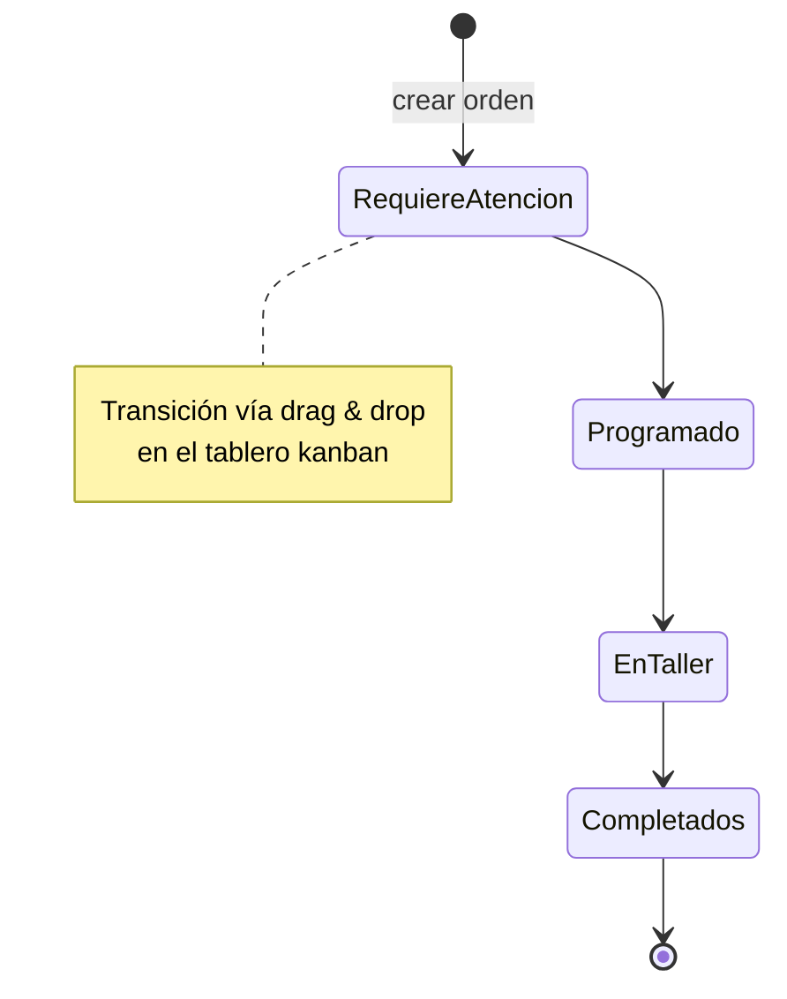
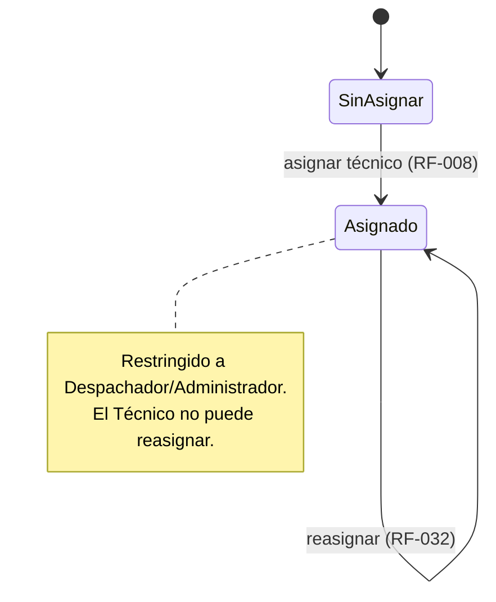
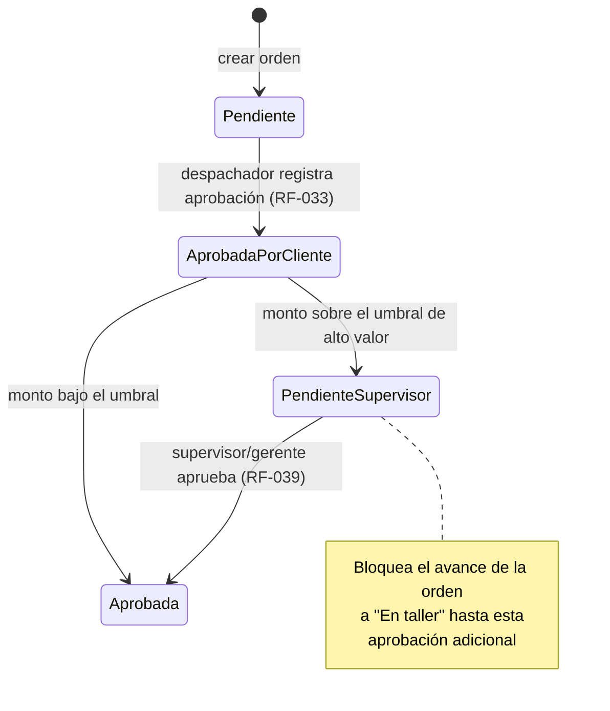
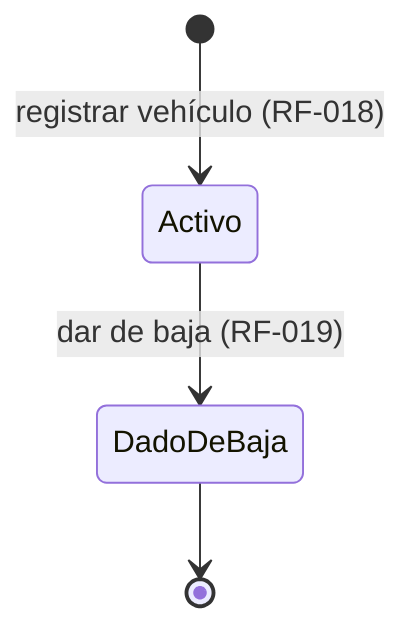

# FloatOps

Sistema de gestión de flota y órdenes de servicio (fleet service management).

> Este documento consolida las decisiones de análisis y diseño tomadas hasta ahora a partir de los wireframes (`Fleet Service Dashboard Wireframes.pptx`). Se actualizará a medida que avance el proyecto.

## Estado del documento

- ✅ = confirmado en los mockups o definido explícitamente por el equipo
- ⚠️ = inferido con evidencia parcial, sujeto a validación
- ❓ = pendiente de definir

---

## 1. Stack tecnológico

**Backend**
- **Java + Quarkus** — framework principal de la API
- **Hibernate ORM with Panache** + **PostgreSQL** — persistencia
- **Quarkus OIDC + Keycloak** — autenticación y autorización (roles pendientes de definir, ver sección 6)
- **Mutiny** — programación reactiva para actualizaciones en tiempo real (kanban, notificaciones futuras)

**Frontend**
- **Kotlin Multiplatform (KMP) + Compose Multiplatform**
  - Módulo `shared`: modelos de dominio, lógica de negocio, cliente HTTP (Ktor client)
  - Target **Web (Wasm/JS)**: dashboard de administración
  - Target **Android/iOS**: vista móvil para técnicos
  - Estado compartido vía `StateFlow` / `ViewModel` en `commonMain`

**Infraestructura**
- Docker Compose (Quarkus + PostgreSQL + Keycloak + MinIO) en desarrollo local
- **MinIO** — almacenamiento de objetos S3-compatible para fotos de órdenes (RF-009/RF-014), en producción sería S3 real (mismo código, `quarkus-amazon-s3`)
- Preparado para Kubernetes si se requiere escalar

**Herramienta de modelado UML**
- **Lucid** (conector MCP) — pendiente de conexión por parte del usuario para generar y mantener el diagrama de clases y el diagrama de casos de uso de forma colaborativa.

---

## 2. Módulos del sistema

Alineados con el menú lateral confirmado en los mockups (`PANEL`, `ÓRDENES DE TRABAJO`, `VEHÍCULOS`, `TÉCNICOS`, `REPUESTOS`, `INFORMES`):

| Módulo | Estado de mockup | Notas |
|---|---|---|
| Panel (Dashboard) | ✅ Completo | KPIs + tabla de vehículos que requieren servicio |
| Órdenes de trabajo | ✅ Completo | Núcleo del sistema: kanban, detalle, formularios, checklist |
| Vehículos | ✅ Completo | Listado, perfil, historial |
| Clientes | ❓ Sin mockup | Módulo nuevo: empresa o persona natural, sin login. Sin pantalla propia aún — se asume asociación inline desde el formulario de vehículo |
| Técnicos | ⚠️ Parcial | Solo vista móvil del técnico; gestión admin confirmada por el equipo, sin mockup aún |
| Repuestos | ⚠️ Parcial | Catálogo visible embebido en el formulario de orden; gestión de inventario confirmada por el equipo, sin mockup aún |
| Informes | ❓ Sin mockup | Confirmado que debe existir, basado en datos almacenados del sistema — alcance por definir |

**Módulos transversales (sin mockup, pero ya confirmados como requeridos por el equipo):**

| Módulo | Estado | Notas |
|---|---|---|
| Autenticación y roles | ✅ Requerido | Login con roles diferenciados. ✅ Ahora son 5 roles: administrador, despachador, técnico, supervisor/gerente, contador/facturación — matriz de permisos por rol aún por confirmar (ver sección 6) |
| Notificaciones | ✅ Requerido | Notificaciones en cada acción relevante del sistema |
| Auditoría | ✅ Requerido (obligatorio) | Trazabilidad de cambios en órdenes, presupuestos y estado de vehículos |
| Administración | ✅ Requerido | Gestión de usuarios y catálogos base (tipos de servicio, categorías de repuestos) |

---

## 3. Modelo de datos preliminar

| Entidad | Campos clave | Relaciones | Notas |
|---|---|---|---|
| `Vehicle` | placa, VIN, marca, modelo, tipo, kilometraje, **estado (activo / dado de baja)** | 1—N `WorkOrder`, N—1 `Client` | Registro/edición y baja de vehículo confirmados como requeridos; campos inferidos a partir del perfil de vehículo visto en el mockup (placa, VIN, marca/modelo, tipo, kilometraje). **Actualización:** FloatOps es un taller de reparación que atiende tanto empresas con flota como personas naturales — ver `Client` |
| `Client` | nombre, **tipo (empresa / persona natural)**, **teléfono, correo, dirección** | 1—N `Vehicle` | ✅ Confirmado: no requiere login ni portal propio. Interactúa presencialmente en el establecimiento o por otro medio de comunicación (ej. teléfono); el despachador registra sus datos. Un cliente de paso (no recurrente) usa los mismos campos obligatorios que cualquier cliente — sin flujo simplificado. ✅ Se asocia al vehículo por dos caminos confirmados: pantalla dedicada de gestión de clientes, o atajo inline desde el formulario de registro de vehículo. ✅ Contacto separado en 3 campos (no un solo texto genérico), confirmado a partir del mockup de Claude Design |
| `WorkOrder` | prioridad, descripción del problema, tipo de servicio, fecha programada, presupuesto, **cotización aprobada (booleano)**, **lista para revisión (booleano)** | N—1 `Vehicle`, N—1 `Technician`, N—1 `Stage`, 1—N `ChecklistItem`, 1—N `Photo`, 1—N `WorkOrderPart` | ✅ Técnico se puede reasignar en cualquier etapa (restringido a Despachador/Administrador). ✅ La cotización requiere aprobación del cliente, registrada manualmente por el despachador (el cliente no tiene acceso al sistema) — ⚠️ pendiente confirmar si bloquea el avance a "En taller" (depende de un criterio aún por explicar). ✅ El técnico marca `listaParaRevision=true` desde móvil; el despachador completa la orden por separado (RF-031), para no chocar con la restricción de rol sobre cambio de etapa |
| `Stage` | nombre, orden/posición, activo | 1—N `WorkOrder` | ✅ Nueva entidad: las etapas del kanban ya no son un enum fijo, son un catálogo configurable por el Administrador. Los 4 valores vistos en el mockup (Requiere atención, Programado, En taller, Completados) son la configuración inicial por defecto, no un límite |
| `Technician` | nombre, especialidad, disponibilidad | 1—N `WorkOrder` | CRUD completo confirmado; el listado/perfil se visualiza **en un modal** desde el panel |
| `ChecklistItem` | descripción, completado, orden | N—1 `WorkOrder` | Estado exacto de "completado" aún no visto explícitamente en el mockup (⚠️ inferido del checkbox) |
| `Part` | código, nombre, stock, precio | N—N `WorkOrder` (vía `WorkOrderPart`) | Gestión de stock / alta de repuesto confirmada como requerida |
| `Photo` | url (key del objeto en S3/MinIO), timestamp | N—1 `WorkOrder` | ✅ Implementado: almacenamiento real vía MinIO (dev) / S3 (producción), no un placeholder. `url` guarda la key interna del objeto, no una URL pública — pendiente generar URLs firmadas temporales (`S3Presigner`, no verificado aún) |
| `Note` | texto, timestamp | N—1 `WorkOrder` | ✅ Agregada — vacío de diseño original de RF-014 (nunca se había modelado), cierre de composición igual que `ChecklistItem`/`Photo` |
| `User` | nombre, credenciales, rol, **última actualización de contraseña, estado (activo / inhabilitado)** | N—1 `Role` | Autenticación vía Keycloak/OIDC. ✅ Contraseña debe rotarse cada 30 días; si no, el usuario queda inhabilitado hasta actualizarla |
| `Role` | nombre (ej. administrador, despachador, técnico) | 1—N `User` | ⚠️ Roles concretos son una propuesta inicial, pendiente de confirmar lista definitiva |
| `Notification` | tipo de evento, mensaje, **canal (in-app / email / WhatsApp)**, leída/no leída, timestamp | N—1 `User` (destinatario) | ✅ Canales confirmados: in-app, email y WhatsApp. Se dispara por acciones del sistema (ver 4.10) |
| `AuditLog` | entidad afectada, campo modificado, valor anterior, valor nuevo, usuario, timestamp | N—1 `User`, referencia polimórfica a la entidad auditada | Obligatorio para `WorkOrder`, presupuesto y estado de `Vehicle` como mínimo |
| `ServiceType` | nombre | 1—N `WorkOrder` | Catálogo base gestionado desde Administración |
| `PartCategory` | nombre | 1—N `Part` | Catálogo base gestionado desde Administración |

**Estados identificados:**
- **Etapa de la orden (kanban):** ✅ ahora es un catálogo configurable (`Stage`), no un enum fijo. La secuencia por defecto sigue siendo `Requiere atención` → `Programado` → `En taller` → `Completados`. El cambio de etapa puede hacerse por drag & drop en el kanban **o** con un botón en el detalle de la orden (✅ confirmado). No hay evidencia de si se permite retroceder o saltar etapas.
- **Asignación de técnico:** `sin asignar` / `asignado a [técnico]` — se resuelve al crear la orden, y ✅ **se puede reasignar en cualquier etapa posterior**, restringido a roles Despachador/Administrador.
- **Aprobación de cotización:** ✅ nuevo — `pendiente` / `aprobada`, registrada manualmente por el despachador tras confirmar con el cliente (que no tiene acceso al sistema). ⚠️ Pendiente confirmar si bloquea el avance de etapa.
- **Estado de vehículo:** `activo` / `dado de baja` (nuevo, agregado por soporte de baja confirmado)
- **Estado de mantenimiento del vehículo** (`Atrasado` / `Próximo a vencer` / `Programado`): distinto de la etapa de la orden; parece calculado según fecha de vencimiento (⚠️ pendiente de confirmar regla de cálculo)
- **Estado de cuenta de usuario:** ✅ nuevo — `activo` / `inhabilitado por contraseña vencida` (rotación obligatoria cada 30 días)

---

## 4. Casos de uso por módulo

### 4.1 Panel (Dashboard)
- Consultar KPIs de flota (vehículos pendientes, órdenes abiertas, total de flota) e incluye la tabla "vehículos que requieren servicio" (RF-002)
- **Navegar al detalle de un vehículo o de una orden desde el panel** ✅ confirmado (RF-003)

> Nota de auditoría: antes esta sección listaba también "tabla densa de todos los vehículos con filtros por estado" como caso de uso de Panel. Se reclasificó a **Vehículos** (RF-016 / RF-034) porque el mockup (slide 5) la titula "FlotaOps · Todos los vehículos", no "Panel" — es la pantalla de listado de flota, no del dashboard.

### 4.2 Órdenes de trabajo
- Consultar tablero kanban por etapa (RF-004)
- **Mover una orden entre etapas del kanban mediante drag & drop** ✅ confirmado (RF-005) — implica que el frontend (Compose Multiplatform) debe soportar gestos de arrastre y el backend un endpoint de actualización de etapa
- **Actualizar la etapa de una orden mediante un botón en el detalle** ✅ confirmado (RF-031) — alternativa al drag & drop
- Consultar cola de órdenes abiertas (RF-037) — ⚠️ caso de uso confirmado en el mockup (slide 4) pero que no tenía RF asignado hasta esta revisión
- Crear orden de trabajo (modal rápido) (RF-006)
- Crear orden de trabajo (página completa con catálogo de repuestos) (RF-007)
- Adjuntar fotos del problema (RF-009)
- Seleccionar repuestos del catálogo y ver presupuesto calculado (estimado / repuestos / restante) (RF-010)
- **Asignar técnico a una orden al momento de crearla** ✅ confirmado (RF-008)
- **Reasignar técnico en cualquier etapa posterior** ✅ confirmado (RF-032) — restringido a roles Despachador/Administrador
- **Registrar la aprobación del cliente sobre la cotización** ✅ confirmado (RF-033) — registrada manualmente por el despachador (⚠️ pendiente confirmar si bloquea el avance de etapa)
- Consultar detalle de orden (descripción, checklist, repuestos usados, fechas, historial) (RF-011)
- Marcar ítems del checklist de una orden (RF-012)
- Consultar orden asignada (vista móvil, técnico) (RF-013)
- Agregar foto y notas a la orden desde la vista móvil (RF-014)
- **Marcar orden lista para revisión desde móvil** ✅ confirmado (RF-015) — el técnico no completa la orden directamente; el despachador la completa por separado moviendo la etapa (RF-031)

> Nota de auditoría: se quitó "Validar campos obligatorios al crear una orden" como línea aparte — es un criterio de aceptación de RF-006/RF-007, no un caso de uso independiente. "Agregar foto desde móvil" y "Agregar notas desde móvil" se fusionaron en una sola línea porque ambas corresponden al mismo RF-014.

### 4.3 Vehículos
- Consultar lista de flota (RF-016)
- Consultar perfil de vehículo (identificación, placa, VIN, tipo, kilometraje), incluyendo historial de órdenes y contador de órdenes abiertas del vehículo (RF-017)
- **Registrar / editar un vehículo** ✅ confirmado (RF-018) — campos inferidos del perfil visto en el mockup: placa, VIN, marca, modelo, tipo, kilometraje. Incluye seleccionar o crear inline el cliente dueño del vehículo como atajo — ✅ confirmado que coexiste con la pantalla dedicada de gestión de clientes (RF-030)
- **Dar de baja un vehículo** ✅ confirmado (RF-019) — requiere campo de estado en `Vehicle`
- **Filtrar listado de vehículos con filtros avanzados (cliente, tipo, estado, etc.)** ✅ confirmado (RF-034) — lista completa de criterios pendiente de definir

### 4.4 Clientes
- **Registrar / editar cliente (empresa o persona natural)** ✅ confirmado (RF-030) — sin distinción de flujo para clientes de paso (no recurrentes): mismos campos obligatorios para todos
- **Asociar vehículo a un cliente** ✅ confirmado (RF-028) — ocurre dentro del formulario de registro de vehículo (RF-018)
- Registrar cotización de un cliente al crear la orden (RF-029) — reutiliza el presupuesto ya calculado

### 4.5 Técnicos
- **Ver lista / perfil de técnicos, disponibilidad y especialidad en un modal desde el panel** ✅ confirmado (RF-020)
- **Registrar / editar un técnico** ✅ confirmado (RF-021, CRUD completo)

> Nota de auditoría: se quitó "Consultar orden asignada y trabajar el checklist (vista móvil)" de esta sección — es RF-012/RF-013, ya documentado en Órdenes de trabajo. Estaba duplicado aquí.

### 4.6 Repuestos
- **Gestionar stock / dar de alta un repuesto** ✅ confirmado (RF-022) — requiere pantalla de administración de inventario (sin mockup aún)

> Nota de auditoría: se quitaron "Consultar catálogo de repuestos dentro del formulario de orden" y "Seleccionar repuestos para una orden" de esta sección — son RF-007/RF-010, ya documentados en Órdenes de trabajo. Estaban duplicados aquí.

### 4.7 Informes
- **Deben existir, basados en la información almacenada en el sistema** ✅ confirmado (RF-023) — alcance de MVP confirmado: 2 informes priorizados:
  - Órdenes por técnico / por período
  - Tiempo promedio de resolución por tipo de servicio

  Candidatos que quedan para una siguiente iteración (no en el MVP):
  - Gasto en repuestos por vehículo o por período
  - Vehículos con mayor frecuencia de incidencias
  - Cumplimiento de mantenimiento programado (a tiempo / atrasado)

  ⚠️ Filtros y formato de exportación de los 2 informes del MVP aún por definir.

### 4.8 Autenticación y roles
- Iniciar sesión con credenciales, restringiendo el acceso a módulos/acciones según el rol del usuario (RF-001) — ej. un técnico solo ve sus órdenes asignadas en móvil
- **Forzar actualización de contraseña cada 30 días** ✅ confirmado (RF-036) — si no se actualiza, el usuario queda inhabilitado; al intentar iniciar sesión con contraseña vencida, se redirige directamente a la pantalla de actualización, sin acceso al resto del sistema
- Cerrar sesión (RF-038) — ⚠️ caso de uso obvio que no tenía RF asignado hasta esta revisión

### 4.9 Administración
- Gestionar usuarios (crear, editar, asignar rol, desactivar) (RF-024)
- Gestionar catálogos base: tipos de servicio y categorías de repuestos (RF-025)
- **Configurar las etapas del tablero kanban (crear, editar, reordenar, desactivar)** ✅ confirmado (RF-035) — ya no son fijas en código

### 4.10 Notificaciones (RF-026)
✅ Canales confirmados: **in-app, email y WhatsApp**. Se confirmó que deben dispararse **en cada acción relevante**. Candidatos derivados de los casos de uso ya definidos:
- Orden creada / orden asignada o reasignada a un técnico
- Orden movida de etapa en el kanban (ej. entra a "Requiere atención")
- Orden marcada como atrasada
- Checklist actualizado / orden completada
- Stock bajo de un repuesto
- Vehículo dado de baja
- Contraseña próxima a vencer / cuenta inhabilitada por contraseña vencida

> Pendiente definir: si todas las notificaciones anteriores aplican para todos los roles o solo para algunos, y los detalles de integración con el proveedor de WhatsApp Business API (ver actor A08 en requerimientos).

### 4.11 Auditoría (RF-027)
- Registrar automáticamente cada cambio en una orden de trabajo (etapa, técnico asignado, checklist, repuestos)
- Registrar automáticamente cada cambio en el presupuesto de una orden
- Registrar automáticamente cada cambio de estado de un vehículo (activo / dado de baja)
- Consultar historial de auditoría de una entidad (¿quién, qué, cuándo?)

> Pendiente definir: si existe una pantalla dedicada de consulta de auditoría, y si aplica a alguna otra entidad además de las tres mencionadas.

---

## 5. Diagramas de estado

### 5.1 Orden de trabajo (etapa del kanban)

> Solo se confirma la secuencia hacia adelante de la configuración **por defecto** (columnas reales del kanban vistas en el mockup: `Requiere atención`, `Programado`, `En taller`, `Completados`). ✅ Las etapas ahora son un catálogo configurable (`Stage`) — un administrador puede agregar, renombrar o reordenar etapas, por lo que este diagrama representa la configuración inicial, no una secuencia fija en código. No hay evidencia de si se permite retroceder o saltar etapas dentro de una configuración dada.

### 5.2 Asignación de técnico

> No hay evidencia de un camino de regreso a "Sin asignar" una vez asignada la orden — solo reasignación a otro técnico.

### 5.3 Aprobación de cotización

> ✅ Confirmado: el criterio de bloqueo es el **valor de la cotización**. Si supera un umbral **configurable por el Administrador** (RF-040, no un valor fijo en código), la orden no avanza a "En taller" sin la aprobación adicional de Supervisor/Gerente (RF-039), además de la aprobación del cliente (RF-033). Por debajo del umbral, solo requiere la aprobación del cliente.

### 5.4 Estado del vehículo

> No hay evidencia de un flujo de reactivación de un vehículo dado de baja.

---

## 6. Decisiones sobre módulos transversales

Confirmadas por el equipo:

1. **Autenticación y roles:** ✅ el sistema requiere login con roles diferenciados. ✅ Ahora son 5 roles confirmados: `administrador`, `despachador`, `técnico`, `supervisor/gerente`, `contador/facturación` — ⚠️ **matriz de permisos por rol aún pendiente de confirmar**. ✅ Además, la contraseña debe rotarse cada 30 días o el usuario queda inhabilitado hasta actualizarla.
2. **Notificaciones:** ✅ requeridas en cada acción relevante del sistema, por los canales **in-app, email y WhatsApp** (ver lista de candidatos en 4.10).
3. **Auditoría:** ✅ obligatoria para órdenes, presupuestos y estado de vehículos. ✅ Confirmado: sí requiere pantalla de consulta dedicada para administradores.
4. **Administración:** ✅ debe existir pantalla de gestión de usuarios, catálogos base (tipos de servicio, categorías de repuestos) **y ahora también de las etapas del kanban** (ver `Stage`).

---

## 7. Próximos pasos

- [x] Auditoría de coherencia entre casos de uso narrativos (sección 4) y RF formales, **en los 11 módulos** — se agregaron RF-037 (cola de órdenes) y RF-038 (cerrar sesión), se fusionaron líneas duplicadas en Vehículos/Administración, y se quitaron duplicados cruzados de módulo en Técnicos/Repuestos que en realidad pertenecían a Órdenes de trabajo
- [x] Diagramas de estado de Panel y Órdenes de trabajo: Panel no tiene entidad propia con ciclo de vida (sin diagrama); Órdenes de trabajo cubierto con etapa del kanban, asignación de técnico y aprobación de cotización (sección 5.1 a 5.3)
- [ ] Conectar Lucid para construir el diagrama de clases (UML) y el diagrama de casos de uso completo de forma colaborativa
- [x] Confirmar matriz de permisos de los 5 roles (administrador, despachador, técnico, supervisor/gerente, contador/facturación)
- [x] Confirmar si auditoría requiere pantalla de consulta dedicada — sí, para administradores
- [x] Confirmar el criterio exacto que determina si la cotización sin aprobar bloquea el avance a "En taller" — cotizaciones de alto valor requieren aprobación de Supervisor/Gerente (RF-039)
- [x] Definir el umbral de valor para cotización "de alto valor" — se confirma que es configurable por el Administrador (RF-040), no un valor fijo
- [x] Agregar `floatops-mobile` al `floatops-realm.json`
- [x] Definir métricas de RNF-001, RNF-004, RNF-005, RNF-006 — confirmadas por Edwin
- [x] Definir formato de exportación de informes — CSV y PDF confirmados
- [x] Definir el flujo de "completar orden" desde la vista móvil — técnico marca lista para revisión, despachador completa
- [x] Definir alcance detallado del módulo de Informes — 2 informes confirmados para MVP (⚠️ falta definir filtros/exportación)
- [x] Confirmar si la asociación vehículo-cliente debe ser inline o en pantallas separadas — ambas coexisten
- [ ] Definir integración concreta con proveedor de WhatsApp Business API — ✅ confirmado que se implementará, pero en una siguiente iteración, no en el arranque del MVP (in-app y email sí van desde el inicio)
- [x] DIAN — confirmado fuera del MVP, siguiente iteración
- [x] Diagrama de estado del vehículo (sección 5.4)
- [ ] Diseñar mockups faltantes: gestión de vehículos (alta/edición/baja), gestión de clientes, gestión de técnicos, gestión de repuestos/inventario, informes, login (incluida pantalla de actualización forzada de contraseña), administración (usuarios/catálogos/etapas del kanban), notificaciones, auditoría